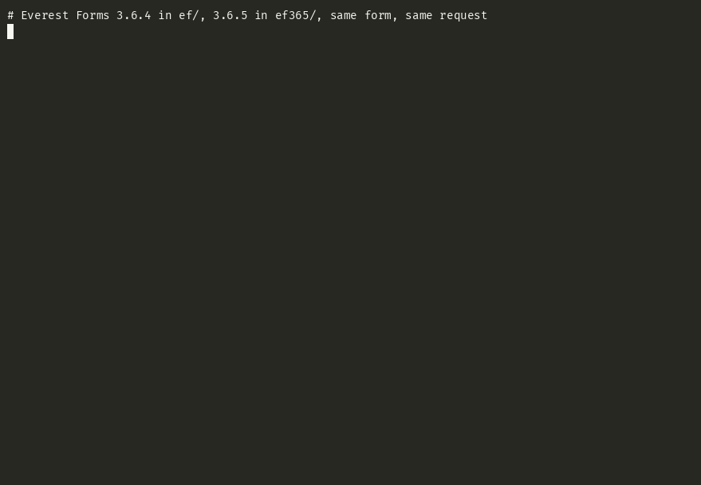

# Everest Forms 3.6.4, file deletion from an anonymous form entry

Proof of concept for **CVE-2026-129024** in
[Everest Forms](https://wordpress.org/plugins/everest-forms/), the WordPress form builder with
about 90,000 active installs. In 3.6.4 and earlier, an anonymous visitor could store a file path in
a form entry, and the plugin deleted that file from `wp-content/uploads` when an administrator later
deleted the entry. Fixed in **3.6.5**, released 2026-11-19.



## The bug

When an entry is deleted, `delete_entry_files()` cleans up the files the entry points to. In 3.6.4 it
treated a value as a signature image path when either the field type was `signature` or the meta key
contained `signature_`:

```php
// includes/class-evf-form-task.php:2303, 3.6.4
if ( preg_match( '/signature_/', $meta_key ) || $field_type === 'signature' ) {
    $this->safe_delete_file( $meta_value, $base_dir );
```

`$base_dir` is the whole uploads directory, and `safe_delete_file()` checked containment with a plain
prefix match, so any file under `wp-content/uploads` qualified.

The meta key comes from the field's label. The plugin's MCP and AI form builder mints it at
`includes/abilities/class-evf-form-builder.php:614`:

```php
$meta_key = sanitize_key( $label . '_' . $counter );
```

So a plain text field labelled **Signature** gets the meta key `signature_3`. Its value is whatever
the visitor types, and on a public form that visitor needs no account.

## Conditions

- A form with a text field whose meta key contains `signature_`. The MCP builder produces this for
  labels ending in "signature", such as `Signature` or `Your Signature`. The drag-and-drop builder
  keys fields by type instead, so forms built there are not affected.
- An administrator permanently deleting the entry, or the form. Moving an entry to the trash does not
  delete files.

That makes the realistic exposure much smaller than the install count.

## Run it

Needs Docker with Compose and Python 3. The stack listens on 127.0.0.1 only.

```sh
./setup.sh 3.6.4    # WordPress 6.8 + Everest Forms 3.6.4, builds the form, plants a victim file
./exploit.sh        # anonymous submission, then the admin deletes the entry
```

Run `docker compose down -v` and then `./setup.sh 3.6.5` to see the fix.

`setup/build-form.php` builds the form by calling the plugin's own `everest-forms/create-form`
ability with a field labelled `Signature`, and prints the meta keys it minted. No meta key is
edited by hand. `exploit.sh` fetches the public page, submits the path in every text field, then
logs in as the administrator and deletes the entry through wp-admin.

The path is resolved from `wp-admin`, where the deletion runs. To target another file:

```sh
./exploit.sh ../wp-content/uploads/some/other/file.pdf
```

Captured runs from empty stacks are in [`evidence/run-3.6.4.log`](evidence/run-3.6.4.log) and
[`evidence/run-3.6.5.log`](evidence/run-3.6.5.log).

## The fix

3.6.5 reworked the cleanup in `delete_entry_files()` and `safe_delete_file()`:

- Only fields configured as signatures are treated as file paths. The meta key alone no longer counts.
- Deletion is confined to the form's own upload and signature folders, not all of uploads.
- The containment check appends a trailing slash, so sibling folders such as `uploads-backup` no
  longer match.
- Null bytes are rejected before the path touches the filesystem.

The same release also closed a related path through payment coupon data. Upgrading to 3.6.5 is the
whole fix.

## Disclosure

Reported through the Patchstack Bug Bounty Program on 2026-11-08 and validated the next day. The
vendor shipped the fix in 3.6.5 on 2026-11-19, and Patchstack published CVE-2026-129024 on
2026-11-22. Run the lab only against systems you own.
